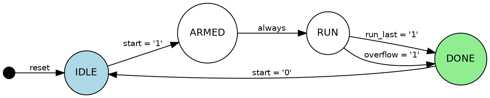
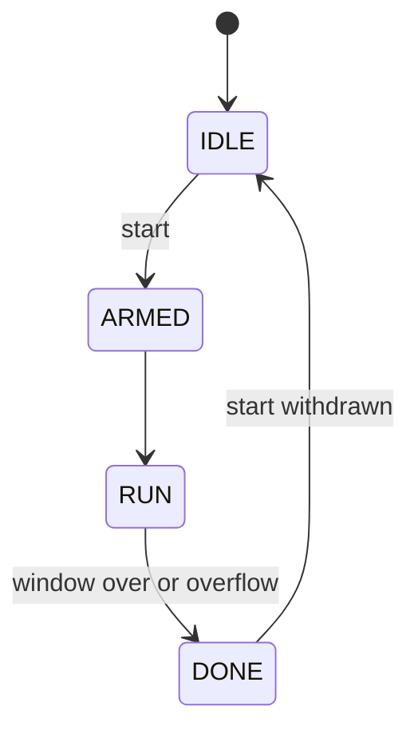

# sample_ctrl

Sampler controller.

Runs one capture window per start request: it arms, enables the capture
path for RUN_CYCLES clock cycles (or until the FIFO overflows), then reports
done and waits for the request to be withdrawn before it can run again.

State sequence: IDLE -> ARMED -> RUN -> DONE -> IDLE.

## Generics

| Name | Type | Default | Description |
| --- | --- | --- | --- |
| `RUN_CYCLES` | positive | `1024` | Length of the capture window in clock cycles. |

## Ports

| Name | Direction | Type | Description |
| --- | --- | --- | --- |
| `clk` | in | std_logic | System clock, rising-edge triggered. |
| `rst` | in | std_logic | Synchronous active-high reset. Returns the FSM to IDLE. |
| `start` | in | std_logic | Start request; held high until the capture is done. |
| `overflow` | in | std_logic | A sample was lost; ends the window early. |
| `capture_en` | out | std_logic | High while samples should be captured. |
| `busy` | out | std_logic | High from arming until the request is withdrawn. |
| `state_code` | out | std_logic_vector(1 downto 0) | Current state, 0 IDLE, 1 ARMED, 2 RUN, 3 DONE. |

## State machine



| From | To | When |
| --- | --- | --- |
| IDLE | ARMED | `start = '1'` |
| ARMED | RUN | always |
| RUN | DONE | `run_last = '1'` |
| RUN | DONE | `overflow = '1'` |
| DONE | IDLE | `start = '0'` |

## Processes

### p_state_reg (process)

Sensitivity: `clk`

p_state_reg: Clocked state register and window counter.
Synchronous reset returns the state to IDLE and clears the counter.

```wavedrom

{ "signal": [
{ "name": "clk",   "wave": "P......." },
{ "name": "rst",   "wave": "1.0....." },
{ "name": "start", "wave": "0..1...." },
{ "name": "state", "wave": "=.=.==..", "data": ["(any)","IDLE","ARMED","RUN"] }
]}
```

### p_next_state (process)

Sensitivity: `state, start, overflow, run_last`

p_next_state: Combinational next-state logic.
A start request arms the controller; the window ends after RUN_CYCLES
cycles or on overflow; DONE is left when the request is withdrawn.

```wavedrom

{ "signal": [
{ "name": "clk",      "wave": "P........." },
{ "name": "start",    "wave": "01.....0.." },
{ "name": "run_last", "wave": "0....10..." },
{ "name": "state",    "wave": "=.==..=.=.", "data": ["IDLE","ARMED","RUN","DONE","IDLE"] }
]}
```

*Controller states*



### p_outputs (process)

Sensitivity: `state`

p_outputs: Combinational Moore output decode.
Capture is enabled in RUN only; busy covers everything but IDLE.

## Clock domains

| Clock | Processes |
| --- | --- |
| `clk` | p_state_reg |

## Reset domains

| Process | Clock | Reset | Style |
| --- | --- | --- | --- |
| `p_state_reg` | clk | rst | sync |
